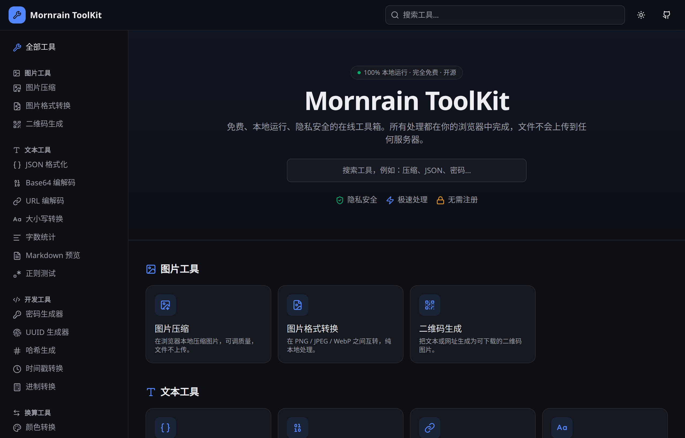
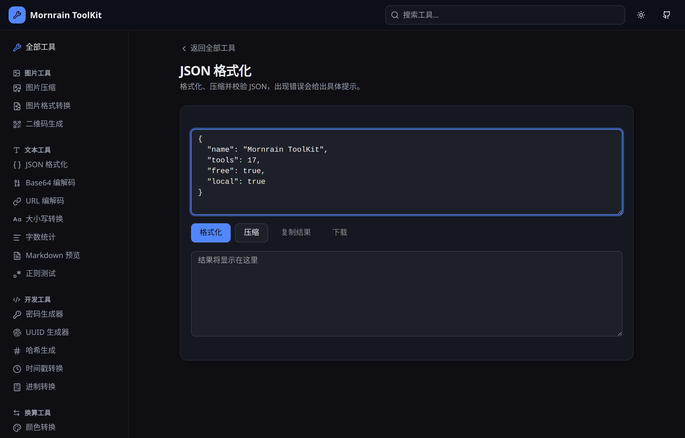

# Mornrain ToolKit

[](https://github.com/mornrain-lin/toolkit/actions/workflows/ci-cd.yml)
[](./LICENSE)
[](https://mornrain-lin.github.io/toolkit/)

一个纯前端、开源免费的在线工具集合。所有处理都在浏览器本地完成，**文件与文本不会上传到任何服务器**，无需注册，打开即用。

> 项目地址：https://github.com/mornrain-lin/toolkit  
> 在线预览：https://mornrain-lin.github.io/toolkit/

---

## 预览



*首页：分类展示 + 搜索，深色主题*



*工具页：统一的头部、清晰的布局、即时的本地处理*

---

## 核心特性

- **100% 本地运行**：图片、文本、密码等全部在浏览器内处理，保护隐私
- **完全免费**：无付费墙、无广告
- **无需注册**：打开即用
- **响应式设计**：桌面左侧导航，移动端抽屉菜单
- **深色 / 浅色主题**：默认深色，偏好本地保存

## 工具清单（17 个）

### 图片工具
- **图片压缩**：可调质量，查看压缩前后体积与减少比例
- **图片格式转换**：PNG / JPEG / WebP 互转
- **二维码生成**：自定义尺寸与颜色，导出 PNG

### 文本工具
- **JSON 格式化**：格式化、压缩、校验，带错误提示
- **Base64 编解码**：支持中文与 emoji
- **URL 编解码**：适用于接口调试
- **大小写转换**：大写 / 小写 / 标题 / 驼峰 / 下划线 / 中划线
- **字数统计**：字符、单词、行数、段落、阅读时间
- **Markdown 预览**：实时渲染，安全过滤，可导出 HTML
- **正则测试**：高亮匹配结果，支持常用标志位

### 开发工具
- **密码生成器**：基于浏览器加密接口，带强度评估
- **UUID 生成器**：批量生成
- **哈希生成**：SHA-1 / 256 / 384 / 512
- **时间戳转换**：Unix 时间戳与日期时间互转
- **进制转换**：二进制 / 八进制 / 十进制 / 十六进制

### 换算工具
- **颜色转换**：HEX / RGB / HSL 互转，支持取色器
- **单位换算**：长度 / 重量 / 温度

---

## 技术栈

- React 19 + TypeScript 5.9
- Vite 7
- Tailwind CSS v4
- shadcn/ui（Radix UI）
- lucide-react

## 本地开发

```bash
cd frontend
pnpm install
pnpm dev
```

然后打开 http://localhost:5173/。

## 构建

```bash
cd frontend
pnpm build
```

产物位于 `frontend/dist/`。

---

## 自动部署

仓库已配置 GitHub Actions（[`.github/workflows/ci-cd.yml`](./.github/workflows/ci-cd.yml)）：

- 每次推送到 `main` 分支自动构建并部署到 **GitHub Pages**
- Pull Request 自动触发构建检查
- SPA 路由通过 `404.html` 回退处理

> 注意：首次使用需在仓库 **Settings → Pages** 中选择 **GitHub Actions** 作为 Source。

---

## 安全与隐私

- 不收集任何用户数据
- 不依赖后端 API
- 敏感操作（密码、哈希）全部使用浏览器原生 `crypto` API

---

## License

[MIT](./LICENSE) © Mornrain
